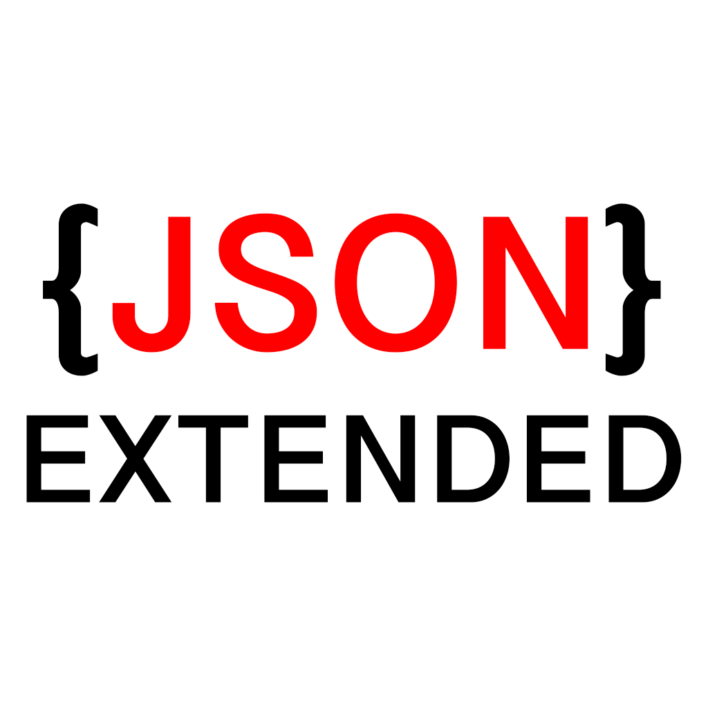

# BTA JSON Extended

Modern-Minecraft-style models for Better Than Adventure 8.0.1: blockstate JSON, JSON item models, OBJ models, model-driven tile entity renderers and Blockbench animations, built on the JSON block models BTA already ships.

**Status:** phase 0 (build and CI). See [PLAN.md](PLAN.md); build commands in [knowledge/build.md](knowledge/build.md).

| | |
| --- | --- |
| Game | Better Than Adventure 8.0.1 |
| Library | HalpLibe 6.2.0+8.0.1 |
| Mod id | `jsonextended` |
| Package | `io.github.tryrodave.jsonextended` |
| Licence | MIT |

Contributors and AI agents: start with [CLAUDE.md](CLAUDE.md).

This project is developed with help from AI (Claude). Every change is built by CI and checked in game by the maintainer before it is merged.
